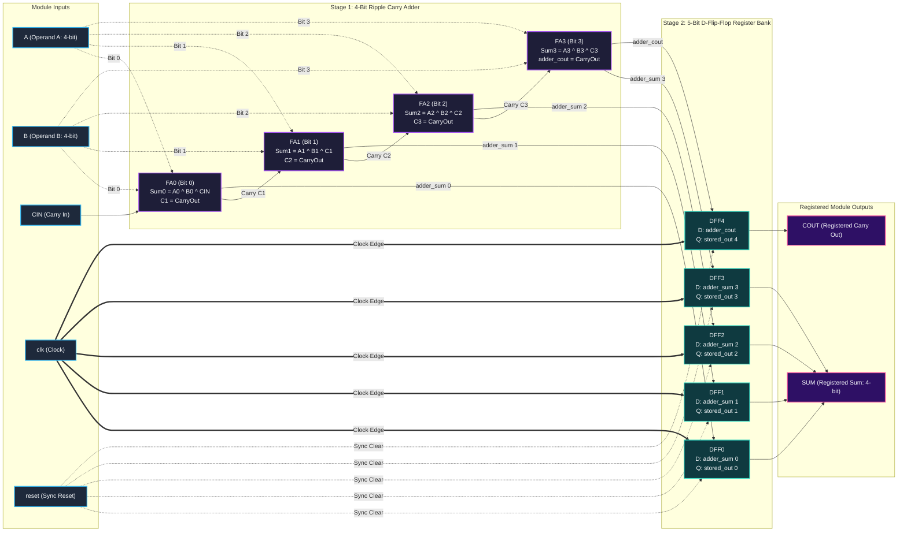

# 4-Bit Ripple Carry Full Adder with Registered Output [D-Flip-Flop Pipeline]

<div align="center">


<p align="center">
  <b>A modular, synthesizable 4-bit Ripple Carry Full Adder integrated with a 5-bit synchronous D-Flip-Flop output register bank for glitch-free, high-performance digital pipelining.</b>
</p>

[Key Features](#-key-features) •
[Architecture & Schematics](#-architecture--schematics) •
[Truth Table](#-truth-table--mathematics) •
[Waveforms & Timing](#-timing--waveform-analysis) •
[Testbench](#-verification--testbench) •
[How to Run](#-how-to-run-simulation)

---

</div>

## 📌 Overview

In high-speed digital arithmetic and ALU architectures, unclocked combinational adders can introduce spurious switching activity (glitches) caused by unequal carry-propagation path delays. 

This project implements a **4-bit Ripple Carry Full Adder with a Synchronous Registered Output Stage**:
1. **Combinational Stage:** Computes the 4-bit binary sum and carry-out from inputs $A[3:0]$, $B[3:0]$, and $CIN$.
2. **Sequential Stage:** Captures and stabilizes $\{COUT, SUM[3:0]\}$ into 5 synchronous D-Flip-Flops on the rising edge of `clk`, governed by an active-high synchronous `reset`.

---

## ⚡ Key Features

- **Hierarchical Modular Design**: Structured across clean abstraction boundaries (`full_adder_1bit` $\rightarrow$ `four_bit_full_adder` $\rightarrow$ `d_flip_flop` $\rightarrow$ `full_adder_with_register`).
- **Synchronous Pipeline Isolation**: Registered outputs eliminate combinational ripple hazards and provide clean timing closure for downstream digital logic.
- **Synchronous Active-High Reset**: Instantly clears all 5 output bits to zero on the clock edge when `reset = 1`.
- **100% Exhaustive Test Coverage**: Self-checking testbench validates all **$16 \times 16 \times 2 = 512$** possible input combinations ($A$, $B$, and $CIN$) with automated error tracking and pass/fail reporting.
- **Tool-Agnostic Synthesis & Sim**: Verified seamlessly across Intel ModelSim / QuestaSim and Icarus Verilog (`iverilog`).

---

## 📐 Architecture & Schematics

### 1. Top-Level Block Schematic (`full_adder_with_register`)

```
                          ┌────────────────────────────────────────────────────────┐
                          │               full_adder_with_register                 │
                          │                                                        │
          A[3:0] ═════════╡═══════════════════════════════╗                        │
          B[3:0] ═════════╡═══════════════════════╗       ║                        │
             CIN ─────────╡───────────────╗       ║       ║                        │
                          │               ▼       ▼       ▼                        │
                          │        ┌────────────────────────────┐                  │
                          │        │    four_bit_full_adder     │                  │
                          │        │                            │                  │
                          │        │  [Bit 3] [Bit 2] [Bit 1] [Bit 0]              │
                          │        └──────┬──────┬──────┬──────┬┘                  │
                          │   adder_cout  │      │      │      │ adder_sum[3:0]    │
                          │        │      │      │      │      │                   │
                          │        ▼      ▼      ▼      ▼      ▼                   │
                          │      ┌───┐  ┌───┐  ┌───┐  ┌───┐  ┌───┐                 │
                          │      │D Q│  │D Q│  │D Q│  │D Q│  │D Q│                 │
             clk ─────────┼─────►│►  │ ►│►  │ ►│►  │ ►│►  │ ►│►  │                 │
           reset ─────────┼──────┤R  │ ─┤R  │ ─┤R  │ ─┤R  │ ─┤R  │                 │
                          │      └───┘  └───┘  └───┘  └───┘  └───┘                 │
                          │      DFF4   DFF3   DFF2   DFF1   DFF0                  │
                          │        │      │      │      │      │                   │
                          │        │      └──────┴──────┴──────┴───► SUM[3:0]     │
                          │        └───────────────────────────────► COUT          │
                          └────────────────────────────────────────────────────────┘
```

### 2. Interactive Structural Diagram (Mermaid)



---

### 3. Gate-Level Implementation of 1-Bit Full Adder (`full_adder_1bit`)

Each 1-bit full adder computes:

$$
\text{SUM} = A \oplus B \oplus \text{CIN}
$$

$$
\text{COUT} = (A \cdot B) + (B \cdot \text{CIN}) + (A \cdot \text{CIN})
$$

```
                   A ───┬───────────────────┐
                        │                   ├───[ XOR 1 ]───┬───────────────┐
                   B ───┼───────────┬───────┘               │               ├───[ XOR 2 ]───► SUM
                        │           │                       │               │
                 CIN ───┼───────────┼───────────────────────┼───────┬───────┘
                        │           │                       │       │
                        │           │                       ▼       ▼
                        ├───[ AND 1 ] (A & B) ────────────►[ OR 1 ]
                        │                                    ▲
                        ├───[ AND 2 ] (B & CIN) ─────────────┤
                        │                                    ▼
                        └───[ AND 3 ] (A & CIN) ──────────►[ OR 2 ]────────────────────────► COUT
```

---

## 📊 Truth Table & Mathematics

### 1-Bit Full Adder Cell

| $A$ | $B$ | $CIN$ | $SUM$ | $COUT$ | Function / Note |
|:---:|:---:|:-----:|:-----:|:------:|:----------------|
| `0` | `0` |  `0`  |  `0`  |  `0`   | $0 + 0 + 0 = 0$ |
| `0` | `0` |  `1`  |  `1`  |  `0`   | $0 + 0 + 1 = 1$ |
| `0` | `1` |  `0`  |  `1`  |  `0`   | $0 + 1 + 0 = 1$ |
| `0` | `1` |  `1`  |  `0`  |  `1`   | $0 + 1 + 1 = 2$ |
| `1` | `0` |  `0`  |  `1`  |  `0`   | $1 + 0 + 0 = 1$ |
| `1` | `0` |  `1`  |  `0`  |  `1`   | $1 + 0 + 1 = 2$ |
| `1` | `1` |  `0`  |  `0`  |  `1`   | $1 + 1 + 0 = 2$ |
| `1` | `1` |  `1`  |  `1`  |  `1`   | $1 + 1 + 1 = 3$ |

### 4-Bit Registered Arithmetic Operation

The complete system computes the registered output at the next rising clock edge ($t + T_{\text{clk}}$):

$$
\{COUT, SUM[3:0]\}_{t + T_{\text{clk}}} = 
\begin{cases} 
5\text{'b}00000, & \text{if } reset = 1 \\\\ 
A[3:0] + B[3:0] + CIN, & \text{if } reset = 0 
\end{cases}
$$

| Operating Mode | Condition | System Output $\{COUT, SUM[3:0]\}$ | Decimal Range |
| :--- | :--- | :--- | :--- |
| **Synchronous Reset** | `reset = 1` | `5'b00000` | $0$ |
| **Normal Addition** | `reset = 0` | $A[3:0] + B[3:0] + CIN$ | $0 \le \text{Result} \le 31$ |

- **Output Bit-Width**: 4-bit operands ($A$, $B$) + 1-bit $CIN$ yield a **5-bit result** ($SUM[3:0]$ and $COUT$).
- **Dynamic Numerical Range**: $0 \le \text{Result} \le 31$ (`5'b00000` $\le \{COUT, SUM\} \le$ `5'b11111`).

---

## ⏱ Timing & Waveform Analysis

The pipeline register delays the presentation of the valid sum and carry-out to the system output by exactly **one clock cycle**, absorbing all combinational ripple settling delays.

```
Cycle:          |       T0      |       T1      |       T2      |       T3      |
Clock (clk)     :   ┌───┐   ┌───┐   ┌───┐   ┌───┐   ┌───┐   ┌───┐   ┌───┐   ┌───┐
                └───┘   └───┘   └───┘   └───┘   └───┘   └───┘   └───┘   └───┘   └───
reset           : ──────┐
                :       └───────────────────────────────────────────────────────────
A[3:0]          : <══ 4'd0 ════><════ 4'd5 ═════><════ 4'd15 ═══><════ 4'd7 ═════>
B[3:0]          : <══ 4'd0 ════><════ 4'd3 ═════><════ 4'd1 ════><════ 4'd2 ═════>
CIN             : <─── 1'b0 ───><──── 1'b0 ─────><──── 1'b0 ────><──── 1'b1 ─────>
adder_sum (comb): <══ 4'd0 ════><════ 4'd8 ═════><════ 4'd0 ════><════ 4'd10 ════>
adder_cout(comb): <─── 1'b0 ───><──── 1'b0 ─────><──── 1'b1 ────><──── 1'b0 ─────>
                :               ▲               ▲               ▲
                :               │ Posedge       │ Posedge       │ Posedge
SUM[3:0] (reg)  : <══ 4'd0 ═════════════════════><════ 4'd8 ═════><════ 4'd0 ═════>
COUT (reg)      : <─── 1'b0 ────────────────────><──── 1'b0 ────><──── 1'b1 ─────>
```

---

## 🧪 Verification & Testbench

The testbench (`4_bit_full_adder_register_tb.v`) implements an **exhaustive verification methodology**:

- **Clock Period**: 10 ns (50 MHz equivalent frequency).
- **Setup Time Compliance**: Stimulus changes at `@(negedge clk)` so combinational ripple propagation fully settles well before the clock edge.
- **Sampling & Strobe**: Output is read and evaluated at `@(posedge clk)` with a `#1` delta delay to model realistic flip-flop clock-to-Q settling time.
- **Vectors Checked**: $16 \ (A) \times 16 \ (B) \times 2 \ (CIN) = 512$ Exhaustive Test Vectors (100% state coverage).

### Execution Results:
```text
------------------------------------------
  4-BIT FULL ADDER WITH DFF TESTBENCH
------------------------------------------
------------------------------------------
ALL 512 TEST CASES PASSED!
------------------------------------------
```

---

## 📂 Source Code Walkthrough

<details>
<summary><b>1. Top-Level Module: <code>4_bit_full_adder_register.v</code> (Click to expand)</b></summary>

```verilog
module full_adder_with_register (
    input [3:0] A,
    input [3:0] B,
    input CIN,
    input clk,
    input reset,

    output [3:0] SUM,
    output COUT
);

    wire [3:0] adder_sum;
    wire adder_cout;
    wire [4:0] stored_output;

    // Instantiate 4-bit Full Adder
    four_bit_full_adder FA (
        .A(A),
        .B(B),
        .CIN(CIN),
        .SUM(adder_sum),
        .COUT(adder_cout)
    );

    // 5x D-Flip-Flops storing SUM[3:0] and COUT
    d_flip_flop DFF0 (.D(adder_sum[0]), .clk(clk), .reset(reset), .Q(stored_output[0]));
    d_flip_flop DFF1 (.D(adder_sum[1]), .clk(clk), .reset(reset), .Q(stored_output[1]));
    d_flip_flop DFF2 (.D(adder_sum[2]), .clk(clk), .reset(reset), .Q(stored_output[2]));
    d_flip_flop DFF3 (.D(adder_sum[3]), .clk(clk), .reset(reset), .Q(stored_output[3]));
    d_flip_flop DFF4 (.D(adder_cout),   .clk(clk), .reset(reset), .Q(stored_output[4]));

    assign SUM  = stored_output[3:0];
    assign COUT = stored_output[4];

endmodule
```
</details>

<details>
<summary><b>2. Ripple Carry Adder: <code>4_bit_full_adder.v</code> (Click to expand)</b></summary>

```verilog
module full_adder_1bit (
    input A,
    input B,
    input CIN,
    output SUM,
    output COUT
);
    assign SUM  = A ^ B ^ CIN;
    assign COUT = (A & B) | (B & CIN) | (A & CIN);
endmodule

module four_bit_full_adder (
    input [3:0] A,
    input [3:0] B,
    input CIN,
    output [3:0] SUM,
    output COUT
);
    wire C1, C2, C3;

    full_adder_1bit FA0 (.A(A[0]), .B(B[0]), .CIN(CIN), .SUM(SUM[0]), .COUT(C1));
    full_adder_1bit FA1 (.A(A[1]), .B(B[1]), .CIN(C1),  .SUM(SUM[1]), .COUT(C2));
    full_adder_1bit FA2 (.A(A[2]), .B(B[2]), .CIN(C2),  .SUM(SUM[2]), .COUT(C3));
    full_adder_1bit FA3 (.A(A[3]), .B(B[3]), .CIN(C3),  .SUM(SUM[3]), .COUT(COUT));
endmodule
```
</details>

<details>
<summary><b>3. Synchronous D-Flip-Flop: <code>d_flip_flop.v</code> (Click to expand)</b></summary>

```verilog
module d_flip_flop (
    input D,
    input clk,
    input reset,
    output reg Q
);
    always @(posedge clk) begin
        if (reset)
            Q <= 1'b0;
        else
            Q <= D;
    end
endmodule
```
</details>

---

## 🚀 How to Run Simulation

### Option A: Using Icarus Verilog (`iverilog`) & `vvp` (Quickest CLI)

```bash
# 1. Compile all Verilog sources and testbench
iverilog -o sim_adder.vvp 4_bit_full_adder.v d_flip_flop.v 4_bit_full_adder_register.v 4_bit_full_adder_register_tb.v

# 2. Run simulation executable
vvp sim_adder.vvp
```

### Option B: Intel ModelSim

**In ModelSim GUI:**
1. Open ModelSim and select **File $\rightarrow$ Change Directory...** to this project folder.
2. In the Transcript window, execute:
   ```tcl
   vlib work
   vlog 4_bit_full_adder.v d_flip_flop.v 4_bit_full_adder_register.v 4_bit_full_adder_register_tb.v
   vsim -gui work.tb_full_adder_with_register
   add wave -r /*
   run -all
   ```

**In Command-Line Batch Mode:**
```bash
vlib work
vlog 4_bit_full_adder.v d_flip_flop.v 4_bit_full_adder_register.v 4_bit_full_adder_register_tb.v
vsim -c -do "run -all; quit" tb_full_adder_with_register
```

---

## 📁 Repository Structure

```
4_bit_adder_register/
├── 4_bit_full_adder.v           # 1-bit FA & 4-bit Ripple Carry Adder modules
├── 4_bit_full_adder_register.v  # Top-level registered adder design
├── 4_bit_full_adder_register_tb.v # Self-checking 512-combination testbench
├── d_flip_flop.v                # Synchronous reset D-Flip-Flop module
├── .gitignore                   # ModelSim, EDA temporary & log exclusions
├── LICENSE                      # MIT Open Source License
└── README.md                    # Interactive documentation & schematics
```

---

## 👨‍💻 Author

**Mugilan S P**
- GitHub: [@mugilansp30](https://github.com/mugilansp30)
- Repository: [4_bit_adder_register](https://github.com/mugilansp30/4_bit_adder_register)

---

## 📄 License

This project is licensed under the [MIT License](LICENSE) — feel free to use, modify, and distribute for educational or commercial designs.
