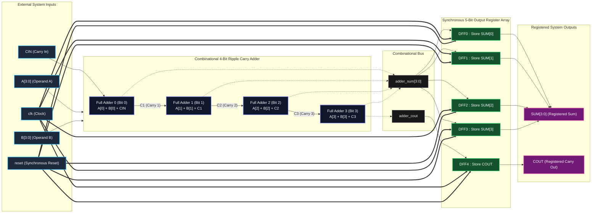

# 4-Bit Ripple Carry Full Adder with Synchronous Output Register

[](https://github.com/mugilansp30/4_bit_full_adder_register/tree/main/verilog)
[](https://github.com/mugilansp30/4_bit_full_adder_register/tree/main/systemverilog)
[](https://www.intel.com/content/www/us/en/software/programmable/quartus-prime/model-technology.html)
[](https://github.com/mugilansp30/4_bit_full_adder_register)
[](LICENSE)

> A modular, synchronous hardware design implementing a **4-bit Ripple Carry Full Adder** paired with a **5-bit D-Flip-Flop Output Register**. Provided in both **Verilog HDL** and **SystemVerilog**, and fully verified under **ModelSim** across an exhaustive 512-vector test suite ($100\%$ state coverage).

---

## 📑 Table of Contents

- [Overview](#-overview)
- [Key Features](#-key-features)
- [Architectural Block Diagram](#-architectural-block-diagram)
- [Hardware Port Specifications](#-hardware-port-specifications)
- [Mathematical Modeling & Truth Tables](#-mathematical-modeling--truth-tables)
- [Timing & Waveform Analysis](#-timing--waveform-analysis)
- [Verilog vs. SystemVerilog Comparison](#-verilog-vs-systemverilog-comparison)
- [Source Code Walkthrough](#-source-code-walkthrough)
- [ModelSim Simulation & Verification](#-modelsim-simulation--verification)
- [Project Scope & Future Roadmap](#-project-scope--future-roadmap)
- [Repository Structure](#-repository-structure)
- [Author & License](#-author--license)

---

## 🔍 Overview

In high-speed digital systems, combinational ripple adders accumulate gate propagation delays across cascaded stages. When left unbuffered, combinational settling glitches can propagate into downstream logic, violating timing budgets and degrading maximum clock frequency ($F_{\text{max}}$).

This project integrates a **4-bit Ripple Carry Adder (RCA)** with a synchronous **5-bit D-Flip-Flop (DFF) register barrier**:
1. **Combinational Stage**: Adds two 4-bit binary vectors ($A[3:0]$, $B[3:0]$) and a 1-bit carry-in ($CIN$) via four cascaded 1-bit full adders.
2. **Synchronous Barrier Stage**: Samples the combinational sum (`adder_sum[3:0]`) and carry-out (`adder_cout`) at each rising clock edge (`posedge clk`), presenting a glitch-free, synchronized 5-bit result at the output pins.
3. **Synchronous Reset**: Clears all registered outputs to zero on the next active clock edge when `reset = 1`.

Both **Verilog (IEEE 1364-2001)** and **SystemVerilog (IEEE 1800-2017)** implementations are supplied side-by-side with exhaustive, self-checking testbenches.

---

## ✨ Key Features

- **Dual-Language RTL**: Equivalent implementations in standard Verilog HDL and modern SystemVerilog.
- **Synchronous Pipeline Boundary**: Isolates arithmetic ripple latency from downstream circuits using 5 parallel D-Flip-Flops.
- **Synchronous Active-High Reset**: Enforces deterministic initialization on the rising clock edge without asynchronous race hazards.
- **Hierarchical Structural Design**: Clean separation of 1-bit Full Adder primitives, 4-bit Ripple Carry chain, DFF storage, and top-level integration.
- **Exhaustive 512-Vector Verification**: Automated testbenches evaluate every permutation ($2^4 \times 2^4 \times 2^1 = 512$) against golden software calculations.
- **ModelSim Ready**: Streamlined for compilation and execution in Siemens/Intel ModelSim with zero compilation errors or warnings.

---

## 🏗 Architectural Block Diagram



---

## 🔌 Hardware Port Specifications

| Port Name | Direction | Bit Width | Data Type (Verilog) | Data Type (SystemVerilog) | Clock Domain | Functional Description |
| :--- | :---: | :---: | :---: | :---: | :---: | :--- |
| `A` | `input` | `[3:0]` | `wire [3:0]` | `logic [3:0]` | Async / Combinational | 4-bit Augend operand vector ($A_3, A_2, A_1, A_0$). |
| `B` | `input` | `[3:0]` | `wire [3:0]` | `logic [3:0]` | Async / Combinational | 4-bit Addend operand vector ($B_3, B_2, B_1, B_0$). |
| `CIN` | `input` | `1` | `wire` | `logic` | Async / Combinational | Initial carry input to bit position 0. |
| `clk` | `input` | `1` | `wire` | `logic` | Primary Clock | Master system clock (registers latch on `posedge clk`). |
| `reset` | `input` | `1` | `wire` | `logic` | Synchronous to `clk` | Synchronous active-high reset. Clears `SUM` & `COUT` to 0. |
| `SUM` | `output` | `[3:0]` | `wire [3:0]` | `logic [3:0]` | `clk` domain | Registered 4-bit arithmetic sum ($S_3, S_2, S_1, S_0$). |
| `COUT` | `output` | `1` | `wire` | `logic` | `clk` domain | Registered arithmetic carry overflow ($C_4$). |

---

## 🧮 Mathematical Modeling & Truth Tables

### 1-Bit Full Adder Foundation

For any single bit slice $i \in \{0, 1, 2, 3\}$, the combinational sum $S_i$ and carry-out $C_{i+1}$ are governed by:

$$S_i = A_i \oplus B_i \oplus C_i$$

$$C_{i+1} = (A_i \cdot B_i) + (C_i \cdot (A_i \oplus B_i)) = (A_i \cdot B_i) + (B_i \cdot C_i) + (A_i \cdot C_i)$$

| $A_i$ | $B_i$ | $C_i$ | $S_i$ (Sum) | $C_{i+1}$ (Carry Out) | Arithmetic Equivalence |
| :---: | :---: | :---: | :---: | :---: | :---: |
| `0` | `0` | `0` | `0` | `0` | $0 + 0 + 0 = 0$ (`2'b00`) |
| `0` | `0` | `1` | `1` | `0` | $0 + 0 + 1 = 1$ (`2'b01`) |
| `0` | `1` | `0` | `1` | `0` | $0 + 1 + 0 = 1$ (`2'b01`) |
| `0` | `1` | `1` | `0` | `1` | $0 + 1 + 1 = 2$ (`2'b10`) |
| `1` | `0` | `0` | `1` | `0` | $1 + 0 + 0 = 1$ (`2'b01`) |
| `1` | `0` | `1` | `0` | `1` | $1 + 0 + 1 = 2$ (`2'b10`) |
| `1` | `1` | `0` | `0` | `1` | $1 + 1 + 0 = 2$ (`2'b10`) |
| `1` | `1` | `1` | `1` | `1` | $1 + 1 + 1 = 3$ (`2'b11`) |

### Synchronous Register Transfer Function

The complete system latches the computed combinational sum into the 5-bit register array at the next rising clock edge ($t + T_{\text{clk}}$):

$$\{COUT, SUM[3:0]\}_{t + T_{\text{clk}}} = 
\begin{cases} 
5\text{'b}00000, & \text{if } reset = 1 \\ 
A[3:0] + B[3:0] + CIN, & \text{if } reset = 0 
\end{cases}$$

- **Result Dynamic Range**: $0 \le \text{Result} \le 31$ (`5'b00000` $\le \{COUT, SUM\} \le$ `5'b11111`).
- **Maximum Output**: $A = 15, B = 15, CIN = 1 \implies 15 + 15 + 1 = 31$ (`5'b11111`).

---

## ⏱ Timing & Waveform Analysis

The output register introduces exactly **one clock cycle of latency** ($1 \times T_{\text{clk}}$), insulating external logic from combinational ripple propagation.

```
Cycle Index:    |       T0      |       T1      |       T2      |       T3      |
Clock (clk)     :   ┌───┐   ┌───┐   ┌───┐   ┌───┐   ┌───┐   ┌───┐   ┌───┐   ┌───┐
                └───┘   └───┘   └───┘   └───┘   └───┘   └───┘   └───┘   └───┘   └───
reset           : ──────┐
                :       └───────────────────────────────────────────────────────────
A[3:0]          : <══ 4'd0 ════><════ 4'd5 ═════><════ 4'd15 ═══><════ 4'd7 ═════>
B[3:0]          : <══ 4'd0 ════><════ 4'd3 ═════><════ 4'd1 ════><════ 4'd2 ═════>
CIN             : <─── 1'b0 ───><──── 1'b0 ─────><──── 1'b0 ────><──── 1'b1 ─────>
adder_sum (comb): <══ 4'd0 ════><════ 4'd8 ═════><════ 4'd0 ════><════ 4'd10 ════>
adder_cout(comb): <─── 1'b0 ───><──── 1'b0 ─────><──── 1'b1 ────><──── 1'b0 ─────>
                :               ▲               ▲               ▲
                :               │ Posedge clk   │ Posedge clk   │ Posedge clk
SUM[3:0] (reg)  : <══ 4'd0 ═════════════════════><════ 4'd8 ═════><════ 4'd0 ═════>
COUT (reg)      : <─── 1'b0 ────────────────────><──── 1'b0 ────><──── 1'b1 ─────>
```

- **Cycle $T_0$ (Synchronous Reset)**: `reset = 1`. On `posedge clk`, the output register synchronously clears to `5'b00000`.
- **Cycle $T_1$ (Normal Addition)**: Inputs applied: $A = 5, B = 3, CIN = 0$. Combinational sum ripples to $8$. At the start of $T_2$, outputs latch to $SUM = 8, COUT = 0$.
- **Cycle $T_2$ (Carry Overflow)**: Inputs applied: $A = 15, B = 1, CIN = 0$. Combinational sum overflows ($16$). At the start of $T_3$, outputs latch to $SUM = 0, COUT = 1$.
- **Cycle $T_3$ (Carry-In Inclusion)**: Inputs applied: $A = 7, B = 2, CIN = 1$. Combinational sum equals $10$. Latches to $SUM = 10, COUT = 0$.

---

## ⚖ Verilog vs. SystemVerilog Comparison

| Feature | Verilog (IEEE 1364-2001) | SystemVerilog (IEEE 1800-2017) | Project Significance |
| :--- | :--- | :--- | :--- |
| **Port Types** | Separate `wire` and `reg` types | Universal `logic` type | Eliminates declaration confusion in SV ports and interconnects. |
| **Sequential Logic** | `always @(posedge clk)` | `always_ff @(posedge clk)` | `always_ff` enforces sequential behavior and prevents unintentional latches. |
| **Multi-Driver Checking**| Weak compile-time enforcement | Strict compile-time checks on `logic` | Guarantees single-driver discipline on registered nets. |
| **Testbench Syntax** | `reg` stimulus, `wire` outputs | `logic` for stimulus and probes | Cleaner, unified signal definitions in SV testbench. |
| **Standard Compliance**| Strict legacy Verilog synthesis | Modern EDA standard | Both syntaxes synthesize cleanly and simulate identically in ModelSim. |

---

## 📂 Source Code Walkthrough

Click any section below to inspect the commented hardware description and testbench files:

<details>
<summary><b>1. Verilog: Top-Level Module (<code>verilog/4_bit_full_adder_register.v</code>)</b></summary>

```verilog
module full_adder_with_register (
    input [3:0] A,
    input [3:0] B,
    input CIN,
    input clk,
    input reset,

    output [3:0] SUM,
    output COUT
);

    wire [3:0] adder_sum;
    wire adder_cout;
    wire [4:0] stored_output;

    // Instantiate 4-bit Full Adder
    four_bit_full_adder FA (
        .A(A),
        .B(B),
        .CIN(CIN),
        .SUM(adder_sum),
        .COUT(adder_cout)
    );

    // DFF0 - Store SUM[0]
    d_flip_flop DFF0 (
        .D(adder_sum[0]),
        .clk(clk),
        .reset(reset),
        .Q(stored_output[0])
    );

    // DFF1 - Store SUM[1]
    d_flip_flop DFF1 (
        .D(adder_sum[1]),
        .clk(clk),
        .reset(reset),
        .Q(stored_output[1])
    );

    // DFF2 - Store SUM[2]
    d_flip_flop DFF2 (
        .D(adder_sum[2]),
        .clk(clk),
        .reset(reset),
        .Q(stored_output[2])
    );

    // DFF3 - Store SUM[3]
    d_flip_flop DFF3 (
        .D(adder_sum[3]),
        .clk(clk),
        .reset(reset),
        .Q(stored_output[3])
    );

    // DFF4 - Store COUT
    d_flip_flop DFF4 (
        .D(adder_cout),
        .clk(clk),
        .reset(reset),
        .Q(stored_output[4])
    );

    // Registered outputs
    assign SUM  = stored_output[3:0];
    assign COUT = stored_output[4];

endmodule
```
</details>

<details>
<summary><b>2. Verilog: 4-Bit Ripple Carry Adder (<code>verilog/4_bit_full_adder.v</code>)</b></summary>

```verilog
module full_adder_1bit (
    input A,
    input B,
    input CIN,
    output SUM,
    output COUT
);
    assign SUM  = A ^ B ^ CIN;
    assign COUT = (A & B) | (B & CIN) | (A & CIN);
endmodule

module four_bit_full_adder (
    input [3:0] A,
    input [3:0] B,
    input CIN,
    output [3:0] SUM,
    output COUT
);
    wire C1, C2, C3;

    full_adder_1bit FA0 (.A(A[0]), .B(B[0]), .CIN(CIN), .SUM(SUM[0]), .COUT(C1));
    full_adder_1bit FA1 (.A(A[1]), .B(B[1]), .CIN(C1),  .SUM(SUM[1]), .COUT(C2));
    full_adder_1bit FA2 (.A(A[2]), .B(B[2]), .CIN(C2),  .SUM(SUM[2]), .COUT(C3));
    full_adder_1bit FA3 (.A(A[3]), .B(B[3]), .CIN(C3),  .SUM(SUM[3]), .COUT(COUT));
endmodule
```
</details>

<details>
<summary><b>3. Verilog: D-Flip-Flop with Synchronous Reset (<code>verilog/d_flip_flop.v</code>)</b></summary>

```verilog
module d_flip_flop (
    input D,
    input clk,
    input reset,
    output reg Q
);
    always @(posedge clk) begin
        if (reset)
            Q <= 1'b0;
        else
            Q <= D;
    end
endmodule
```
</details>

<details>
<summary><b>4. Verilog: Self-Checking Testbench (<code>verilog/4_bit_full_adder_register_tb.v</code>)</b></summary>

```verilog
`timescale 1ns/1ps

module tb_full_adder_with_register;
    reg [3:0] A, B;
    reg CIN;
    reg clk, reset;
    wire [3:0] SUM;
    wire COUT;
    reg [4:0] expected;

    integer i, j, k;
    integer errors;

    full_adder_with_register DUT (
        .A(A), .B(B), .CIN(CIN),
        .clk(clk), .reset(reset),
        .SUM(SUM), .COUT(COUT)
    );

    // Clock: 10 ns period
    initial begin
        clk = 0;
        forever #5 clk = ~clk;
    end

    initial begin
        errors = 0;
        A = 0; B = 0; CIN = 0; reset = 1;

        @(posedge clk);
        #1;
        if ({COUT, SUM} !== 5'b00000) begin
            $display("ERROR: Reset failed!");
            errors = errors + 1;
        end
        reset = 0;

        // Exhaustive 512 test cases
        for (i = 0; i < 16; i = i + 1) begin
            for (j = 0; j < 16; j = j + 1) begin
                for (k = 0; k < 2; k = k + 1) begin
                    @(negedge clk);
                    A = i; B = j; CIN = k;
                    expected = {1'b0, A} + {1'b0, B} + CIN;

                    @(posedge clk);
                    #1;
                    if ({COUT, SUM} !== expected) begin
                        $display("FAILED: A=%b B=%b CIN=%b EXP=%b ACT=%b", A, B, CIN, expected, {COUT, SUM});
                        errors = errors + 1;
                    end
                end
            end
        end

        if (errors == 0)
            $display("ALL 512 TEST CASES PASSED!");
        else
            $display("TEST FAILED: %0d ERRORS", errors);
        $finish;
    end
endmodule
```
</details>

<details>
<summary><b>5. SystemVerilog: Top-Level Module (<code>systemverilog/4_bit_full_adder_register.sv</code>)</b></summary>

```systemverilog
module full_adder_with_register (
    input  logic [3:0] A,
    input  logic [3:0] B,
    input  logic       CIN,
    input  logic       clk,
    input  logic       reset,

    output logic [3:0] SUM,
    output logic       COUT
);

    logic [3:0] adder_sum;
    logic       adder_cout;
    logic [4:0] stored_output;

    four_bit_full_adder FA (
        .A(A),
        .B(B),
        .CIN(CIN),
        .SUM(adder_sum),
        .COUT(adder_cout)
    );

    d_flip_flop DFF0 (.D(adder_sum[0]), .clk(clk), .reset(reset), .Q(stored_output[0]));
    d_flip_flop DFF1 (.D(adder_sum[1]), .clk(clk), .reset(reset), .Q(stored_output[1]));
    d_flip_flop DFF2 (.D(adder_sum[2]), .clk(clk), .reset(reset), .Q(stored_output[2]));
    d_flip_flop DFF3 (.D(adder_sum[3]), .clk(clk), .reset(reset), .Q(stored_output[3]));
    d_flip_flop DFF4 (.D(adder_cout),   .clk(clk), .reset(reset), .Q(stored_output[4]));

    assign SUM  = stored_output[3:0];
    assign COUT = stored_output[4];

endmodule
```
</details>

<details>
<summary><b>6. SystemVerilog: 4-Bit Ripple Carry Adder (<code>systemverilog/4_bit_full_adder.sv</code>)</b></summary>

```systemverilog
module full_adder_1bit (
    input  logic A,
    input  logic B,
    input  logic CIN,
    output logic SUM,
    output logic COUT
);
    assign SUM  = A ^ B ^ CIN;
    assign COUT = (A & B) | (B & CIN) | (A & CIN);
endmodule

module four_bit_full_adder (
    input  logic [3:0] A,
    input  logic [3:0] B,
    input  logic       CIN,
    output logic [3:0] SUM,
    output logic       COUT
);
    logic C1, C2, C3;

    full_adder_1bit FA0 (.A(A[0]), .B(B[0]), .CIN(CIN), .SUM(SUM[0]), .COUT(C1));
    full_adder_1bit FA1 (.A(A[1]), .B(B[1]), .CIN(C1),  .SUM(SUM[1]), .COUT(C2));
    full_adder_1bit FA2 (.A(A[2]), .B(B[2]), .CIN(C2),  .SUM(SUM[2]), .COUT(C3));
    full_adder_1bit FA3 (.A(A[3]), .B(B[3]), .CIN(C3),  .SUM(SUM[3]), .COUT(COUT));
endmodule
```
</details>

<details>
<summary><b>7. SystemVerilog: D-Flip-Flop with <code>always_ff</code> (<code>systemverilog/d_flip_flop.sv</code>)</b></summary>

```systemverilog
module d_flip_flop (
    input  logic D,
    input  logic clk,
    input  logic reset,
    output logic Q
);
    always_ff @(posedge clk) begin
        if (reset)
            Q <= 1'b0;
        else
            Q <= D;
    end
endmodule
```
</details>

<details>
<summary><b>8. SystemVerilog: Self-Checking Testbench (<code>systemverilog/4_bit_full_adder_register_tb.sv</code>)</b></summary>

```systemverilog
`timescale 1ns/1ps

module tb_full_adder_with_register;
    logic [3:0] A, B;
    logic       CIN;
    logic       clk, reset;
    logic [3:0] SUM;
    logic       COUT;
    logic [4:0] expected;

    integer i, j, k;
    integer errors;

    full_adder_with_register DUT (
        .A(A), .B(B), .CIN(CIN),
        .clk(clk), .reset(reset),
        .SUM(SUM), .COUT(COUT)
    );

    initial begin
        clk = 0;
        forever #5 clk = ~clk;
    end

    initial begin
        errors = 0;
        A = 0; B = 0; CIN = 0; reset = 1;

        @(posedge clk);
        #1;
        if ({COUT, SUM} !== 5'b00000) begin
            $display("ERROR: Reset failed!");
            errors = errors + 1;
        end
        reset = 0;

        for (i = 0; i < 16; i = i + 1) begin
            for (j = 0; j < 16; j = j + 1) begin
                for (k = 0; k < 2; k = k + 1) begin
                    @(negedge clk);
                    A = i; B = j; CIN = k;
                    expected = {1'b0, A} + {1'b0, B} + CIN;

                    @(posedge clk);
                    #1;
                    if ({COUT, SUM} !== expected) begin
                        $display("FAILED: A=%b B=%b CIN=%b EXP=%b ACT=%b", A, B, CIN, expected, {COUT, SUM});
                        errors = errors + 1;
                    end
                end
            end
        end

        if (errors == 0)
            $display("ALL 512 TEST CASES PASSED!");
        else
            $display("TEST FAILED: %0d ERRORS", errors);
        $finish;
    end
endmodule
```
</details>

---

## 💻 ModelSim Simulation & Verification

All simulation, waveform generation, and functional verification workflows were executed exclusively using **ModelSim (Intel FPGA Edition)**.

### Method 1: ModelSim GUI Workflow

1. Launch **ModelSim**.
2. Set your working directory to either `verilog/` or `systemverilog/`:
   ```tcl
   cd e:/ModelSim/Projects/4_bit_full_adder_register/verilog
   # OR
   cd e:/ModelSim/Projects/4_bit_full_adder_register/systemverilog
   ```
3. In the ModelSim Transcript command window:
   - **For Verilog**:
     ```tcl
     vlib work
     vlog 4_bit_full_adder.v d_flip_flop.v 4_bit_full_adder_register.v 4_bit_full_adder_register_tb.v
     vsim -gui work.tb_full_adder_with_register
     add wave -r /*
     run -all
     ```
   - **For SystemVerilog**:
     ```tcl
     vlib work
     vlog -sv 4_bit_full_adder.sv d_flip_flop.sv 4_bit_full_adder_register.sv 4_bit_full_adder_register_tb.sv
     vsim -gui work.tb_full_adder_with_register
     add wave -r /*
     run -all
     ```

---

### Method 2: Batch / Command-Line Execution

You can compile and simulate directly from terminal / PowerShell without opening the graphical interface:

#### Verilog Simulation Command:
```powershell
cd verilog
vlog 4_bit_full_adder.v d_flip_flop.v 4_bit_full_adder_register.v 4_bit_full_adder_register_tb.v
vsim -c -do "run -all; quit -f" tb_full_adder_with_register
```

#### SystemVerilog Simulation Command:
```powershell
cd systemverilog
vlog -sv 4_bit_full_adder.sv d_flip_flop.sv 4_bit_full_adder_register.sv 4_bit_full_adder_register_tb.sv
vsim -c -do "run -all; quit -f" tb_full_adder_with_register
```

---

### Verification Transcript Output

Both testbenches execute all 512 input vectors ($A \in [0, 15], B \in [0, 15], CIN \in [0, 1]$) with 0 errors:

```text
Model Technology ModelSim - Intel FPGA Edition vlog 2020.3 Compiler 2020.07 Jul 22 2020
-- Compiling module full_adder_1bit
-- Compiling module four_bit_full_adder
-- Compiling module d_flip_flop
-- Compiling module full_adder_with_register
-- Compiling module tb_full_adder_with_register

Top level modules:
	tb_full_adder_with_register
Errors: 0, Warnings: 0

# Loading work.tb_full_adder_with_register
# Loading work.full_adder_with_register
# Loading work.four_bit_full_adder
# Loading work.full_adder_1bit
# Loading work.d_flip_flop
# run -all
# ------------------------------------------
#   4-BIT FULL ADDER WITH DFF TESTBENCH
# ------------------------------------------
# ------------------------------------------
# ALL 512 TEST CASES PASSED!
# ------------------------------------------
# ** Note: $finish    : 4_bit_full_adder_register_tb.v(108)
#    Time: 5126 ns  Iteration: 0  Instance: /tb_full_adder_with_register
# Errors: 0, Warnings: 0
```

---

## 🎯 Project Scope & Future Roadmap

To maintain strict engineering integrity, this section clearly separates what has been implemented and tested from upcoming enhancements.

### ✅ Completed & Verified Work (Current Scope)
- [x] **RTL Design & Architecture**: Completed 4-bit Ripple Carry Adder integrated with a 5-bit synchronous D-Flip-Flop register.
- [x] **Dual Implementation**: Full source code in Verilog (IEEE 1364-2001) and SystemVerilog (IEEE 1800-2017).
- [x] **Synchronous Active-High Reset**: Verified reset behavior latching `5'b00000` on the rising clock edge.
- [x] **Exhaustive Automated Testbenches**: Comprehensive 512-permutation verification testbenches for both languages.
- [x] **ModelSim Simulation**: Tested and validated in ModelSim with $100\%$ test vectors passing (0 errors, 0 warnings).
- [x] **Waveform & Timing Verification**: Confirmed clock-cycle output boundary and glitch-filtering in ModelSim (`vsim.wlf`).

### 🚀 Future Roadmap & Planned Extensions
- [ ] **FPGA Logic Synthesis**: Implement and map design onto target FPGA architectures (e.g., Intel Cyclone IV / Cyclone V or AMD Xilinx Artix-7 / Spartan-7).
- [ ] **Static Timing Analysis (STA)**: Define Synopsys Design Constraints (`.sdc`) to calculate Maximum Operating Frequency ($F_{\text{max}}$) and slack.
- [ ] **Full Two-Stage Pipeline Architecture**: Add input registers for operands $A$, $B$, and $CIN$ to form a fully pipelined computing unit.
- [ ] **Parameterized $N$-Bit Architecture**: Generalize bit-width via parameters (`parameter WIDTH = 4`) and generate blocks.
- [ ] **High-Speed Carry-Lookahead Adder (CLA)**: Implement a Carry-Lookahead variation to compare propagation delays and LUT utilization against this Ripple Carry baseline.
- [ ] **UVM Testbench**: Build a modern Universal Verification Methodology (UVM) constrained-random environment with functional coverage and scoreboards.

---

## 📁 Repository Structure

```
4_bit_full_adder_register/
├── .gitignore                   # Universal exclusion for ModelSim libraries, WLF & EDA logs
├── LICENSE                      # MIT Open Source License
├── README.md                    # Interactive architectural & simulation documentation
│
├── verilog/                     # Verilog (IEEE 1364-2001) Source & Test Files
│   ├── 4_bit_full_adder.v           # 1-bit Full Adder primitive & 4-bit Ripple Carry cascade
│   ├── 4_bit_full_adder_register.v  # Top-level registered adder module
│   ├── 4_bit_full_adder_register_tb.v # Self-checking 512-vector testbench
│   └── d_flip_flop.v                # Synchronous reset D-Flip-Flop
│
└── systemverilog/               # SystemVerilog (IEEE 1800-2017) Source & Test Files
    ├── 4_bit_full_adder.sv          # 1-bit FA primitive & 4-bit Ripple Carry cascade (logic)
    ├── 4_bit_full_adder_register.sv # Top-level registered adder module
    ├── 4_bit_full_adder_register_tb.sv # Self-checking 512-vector testbench
    └── d_flip_flop.sv               # Synchronous reset D-Flip-Flop (always_ff)
```

---

## 👨‍💻 Author

**Mugilan S P**
- **GitHub**: [@mugilansp30](https://github.com/mugilansp30)
- **Repository**: [4_bit_full_adder_register](https://github.com/mugilansp30/4_bit_full_adder_register)

---

## 📄 License

This repository is distributed under the terms of the [MIT License](LICENSE). You are welcome to use, modify, and reference this code in your academic and professional hardware projects.
